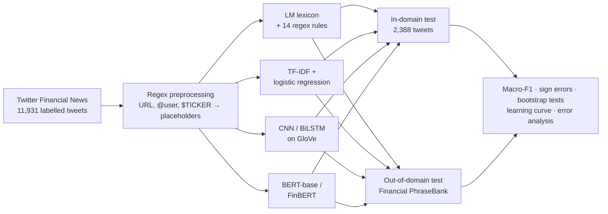
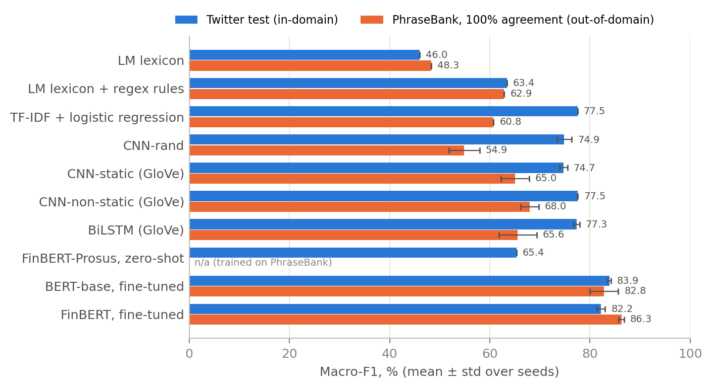
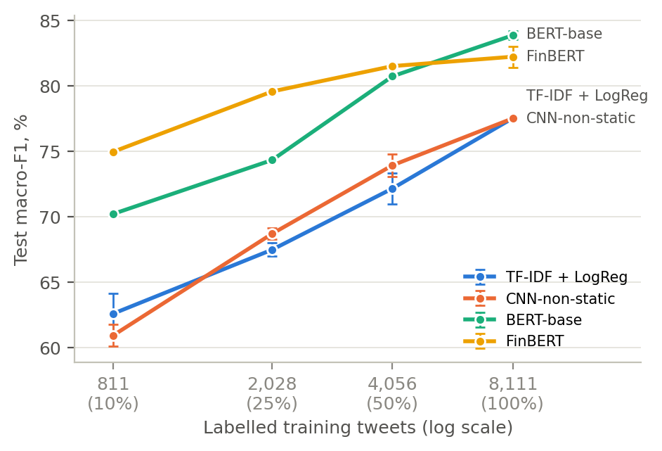

# Bullish or Bearish? From Regex to FinBERT

**Financial news sentiment with every model family from a Language Technologies course:
regular expressions, TF-IDF, CNN, BiLSTM, BERT and FinBERT.**

Quantitative investors turn news into trading signals. The basic building block is a classifier that reads
one headline and decides whether it is good news (**Bullish**), bad news (**Bearish**) or neither (**Neutral**)
for the stock:

| Headline | Label |
| --- | --- |
| *Synaptics stock price target raised to $40 from $32 at J.P. Morgan* | Bullish |
| *Autodesk downgraded to underweight from neutral at JPMorgan* | Bearish |
| *JPMorgan expands private credit group* | Neutral |

This project builds that block with one model from every lecture of the course, compares them on the same data,
and tests what happens on formal news text they never saw. It is the experimental homework for the
*Language Technologies* course (report + presentation).

## Why this matters

BlackRock's systematic team writes that its early text signals simply counted positive and negative words in
broker reports, earnings calls and news, and that it now uses Transformer language models
([Savi, Shen & Tsaig, 2023](https://insurancebiz.co.za/news/wealth-and-investments/how-artificial-intelligence-is-transforming-investing-blackrock-systematic.html)).
J.P. Morgan's *Big Data and AI Strategies* report lists news sentiment among the core alternative data sets
(Kolanovic & Krishnamachari, 2017). That path from word counts to Transformers is exactly the path of the course.

## Research questions

1. **Model families:** how do rules, linear models, CNNs, RNNs and Transformers compare?
2. **Domain pre-training:** does FinBERT (BERT pre-trained on financial text) beat general-domain BERT?
3. **Domain shift:** do models trained on tweets still work on formal financial news?
4. **Data efficiency:** how many labelled examples does each approach need?

## Pipeline



## Data

- **Twitter Financial News Sentiment** ([Hugging Face](https://huggingface.co/datasets/zeroshot/twitter-financial-news-sentiment), MIT):
  11,931 English tweets from financial news accounts. The official validation split (2,388 tweets) is the test set;
  15% of the training split (stratified) is the development set used for every model choice.
  65% of tweets are Neutral, so **macro-F1** is the main metric (always answering Neutral scores 26.4).
- **Financial PhraseBank** (Malo et al., 2014): 4,846 formal news sentences, used **only** as an out-of-domain test set.
- **Loughran–McDonald dictionary** (finance word lists) and **GloVe** 100-d vectors.

None of the third-party data is stored here: `./get_data.sh` downloads it (sources and licences in [data/README.md](data/README.md)).

## Models: one per lecture

| Lecture | Model | What it reads | Trained weights |
| --- | --- | --- | --- |
| Regular expressions | Loughran–McDonald lexicon, then + 14 hand-written regex rules | word counts, rule matches | ≈ 0 |
| Neural network basics | TF-IDF + logistic regression | word 1–2-grams + character 2–5-grams | 0.17 M |
| Word embeddings + CNN | Kim (2014) CNN: rand / static / non-static | GloVe 100-d vectors | 1.55 M |
| RNNs | BiLSTM with max-pooling | GloVe 100-d vectors | 1.67 M |
| Transformers + BERT | BERT-base, fine-tuned | general-English WordPiece | 110 M |
| BERT for finance | FinBERT (Yang et al., 2020), fine-tuned | finance WordPiece, 4.9 B tokens of financial text | 110 M |
| (no training) | FinBERT-Prosus (Araci, 2019), zero-shot | already trained on PhraseBank | 0 |

One regex rule even parses numbers: in *target raised to $40 from $32* the pattern `to \$?(\d+) from \$?(\d+)`
extracts both prices and their difference gives the direction.

## Results

Macro-F1 (%) on the Twitter test set and on PhraseBank (never seen in training); mean ± std over 3 seeds for neural models.

| Model | Test macro-F1 | Test accuracy | Sign errors | PhraseBank 100% agree | PhraseBank ≥50% agree |
| --- | --- | --- | --- | --- | --- |
| Always Neutral | 26.4 | 65.6 | 0.0 | 25.4 | 24.8 |
| LM lexicon | 46.0 | 60.1 | 6.8 | 48.3 | 50.4 |
| LM lexicon + regex rules | 63.4 | 69.2 | 6.4 | 62.9 | 58.1 |
| TF-IDF + logistic regression | 77.5 | 84.3 | 6.7 | 60.8 | 50.6 |
| CNN-rand | 74.9 ± 1.5 | 82.6 ± 0.8 | 8.6 ± 1.3 | 54.9 ± 3.1 | 46.4 ± 2.3 |
| CNN-static (GloVe) | 74.7 ± 0.8 | 82.1 ± 0.6 | 9.7 ± 1.4 | 65.0 ± 2.8 | 53.4 ± 2.4 |
| CNN-non-static (GloVe) | 77.5 ± 0.1 | 83.7 ± 0.0 | 6.9 ± 0.4 | 68.0 ± 1.8 | 56.1 ± 1.4 |
| BiLSTM (GloVe) | 77.3 ± 0.6 | 83.1 ± 0.9 | 7.9 ± 0.8 | 65.6 ± 3.8 | 54.9 ± 2.7 |
| FinBERT-Prosus, zero-shot | 65.4 | 70.1 | 9.4 | (trained on it) | (trained on it) |
| BERT-base, fine-tuned* | 83.9 ± 0.3 | 87.5 ± 0.2 | 3.8 ± 0.3 | 82.8 ± 2.8 | 67.1 ± 2.2 |
| FinBERT, fine-tuned* | 82.2 ± 0.8 | 86.4 ± 0.8 | 5.8 ± 1.0 | 86.3 ± 0.6 | 69.4 ± 0.9 |

\* preliminary (2 of 3 seeds); updated when the last runs finish. Full tables: [results/summary.txt](results/summary.txt).
*Sign errors* = share of truly bullish or bearish tweets labelled with the opposite direction, the costliest
mistake for a trading signal.



### Key findings

- **Transformers win in-domain:** fine-tuned BERT and FinBERT beat the best classical model by 4–6 macro-F1 points
  (paired bootstrap, 95% CI above zero for every seed).
- **The classical models tie:** TF-IDF, the GloVe CNN and the BiLSTM are statistically indistinguishable (≈ 77.5).
- **Regex rules are cheap and robust:** 14 rules add 17.4 points to the finance lexicon with zero training,
  and the rule-based model transfers to formal news as well as TF-IDF.
- **Domain shift separates the models:** TF-IDF loses 17 points on PhraseBank, GloVe models about 10;
  FinBERT is the only model that does not drop.
- **Finance pre-training pays off off-domain and with little data, not in-domain** (see the learning curve).
- **JPMorgan in a headline is rarely news about JPMorgan:** in 46 of the 64 test tweets that name a big bank,
  the bank is only the messenger (*Netflix downgraded to underperform at Wells Fargo*); only 4 of 47
  directional bank tweets carry sentiment about the bank. A trading signal needs target-dependent sentiment.
- **Remaining sign errors** come from numbers that must be compared (*EPS 78 cents vs. 98 cents*), negation,
  mixed cues and market jargon ([hand-labelled causes](results/finbert_seed1_sign_errors_by_cause.csv)).



## Repository layout

```
get_data.sh               downloads the third-party data (see data/README.md)
explore_data.py           first look at the datasets
src/
  common.py               data loading, regex preprocessing, splits, metrics
  run_lexicon.py          LM lexicon and LM + regex rules
  run_tfidf.py            TF-IDF + logistic regression (+ preprocessing ablation, learning curve)
  run_neural.py           Kim CNN (rand / static / non-static) and BiLSTM on GloVe
  run_bert.py             BERT-base and FinBERT fine-tuning; FinBERT-Prosus zero-shot
  make_report_assets.py   tables, figures, McNemar + bootstrap tests, error analysis -> results/summary.txt
  case_study_banks.py     JPMorgan / Goldman Sachs / BlackRock case study
  tokenizer_stats.py      BERT vs FinBERT vocabularies on the tweets
  build_report.py         report Markdown -> A4 PDF (headless Chrome) + DOCX (pandoc)
  queue_learning_curve.sh helper that queues learning-curve runs
data/bank_mentions_test_roles.csv   hand-labelled role of the bank in 64 test tweets
results/                  one JSON per (model, seed), test predictions, tables, summary.txt, logs/
figures/                  figures used in the report
report/                   the written report (PDF, DOCX) and its print style
```

## Reproduce

Python 3.11+; an Apple-silicon GPU (MPS) or CUDA GPU is recommended for the Transformers (~15 min per run on an M3).

```bash
pip install -r requirements.txt
./get_data.sh

python src/run_lexicon.py
python src/run_tfidf.py
python src/run_neural.py                      # 4 variants x 3 seeds
python src/run_bert.py --model prosus-zeroshot
python src/run_bert.py --model finbert        # 3 seeds
python src/run_bert.py --model bert
# learning curve: 10/25/50% of the training data, 3 seeds (each draws its own subset)
for f in 0.1 0.25 0.5; do
  for s in 1 2 3; do python src/run_tfidf.py --variants norm+char --frac $f --seed $s; done
  python src/run_neural.py --models cnn-nonstatic --seeds 1 2 3 --frac $f
  python src/run_bert.py --model bert --seeds 1 2 3 --frac $f
  python src/run_bert.py --model finbert --seeds 1 2 3 --frac $f
done
python src/make_report_assets.py              # tables, figures, significance tests -> results/, figures/
python src/case_study_banks.py
python src/tokenizer_stats.py
```

All model selection uses the development set; the test sets are used once. Hyperparameters are listed in the report
and in each script's docstring.

## References

- Araci (2019). FinBERT: financial sentiment analysis with pre-trained language models. arXiv:1908.10063.
- Berg-Kirkpatrick, Burkett & Klein (2012). An empirical investigation of statistical significance in NLP. EMNLP-CoNLL.
- Devlin et al. (2019). BERT: pre-training of deep bidirectional Transformers for language understanding. NAACL-HLT.
- Hochreiter & Schmidhuber (1997). Long short-term memory. Neural Computation 9(8).
- Kim (2014). Convolutional neural networks for sentence classification. EMNLP.
- Kolanovic & Krishnamachari (2017). Big Data and AI Strategies. J.P. Morgan.
- Loughran & McDonald (2011). When is a liability not a liability? Journal of Finance 66(1).
- Malo et al. (2014). Good debt or bad debt: detecting semantic orientations in economic texts. JASIST 65(4).
- Pennington, Socher & Manning (2014). GloVe: global vectors for word representation. EMNLP.
- Savi, Shen & Tsaig (2023). How artificial intelligence is transforming investing: BlackRock Systematic.
- Vaswani et al. (2017). Attention is all you need. NeurIPS.
- Yang, Uy & Huang (2020). FinBERT: a pretrained language model for financial communications. arXiv:2006.08097.
